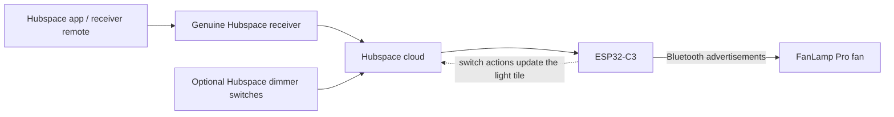

# Hubspace → FanLamp Pro bridge

Control a FanLamp Pro ceiling fan from Hubspace using an ESP32-C3. The ESP32 receives cloud events and sends the fan's existing Bluetooth advertisement protocol. Once configured, it runs from USB power: no Home Assistant server or computer is required.

This grew out of a working home project: a DC fan that spoke FanLamp Pro, a Hubspace receiver that only supported AC motors, and a desire to use the same app and kitchen dimmers for both. The useful part of the receiver turned out to be its connection to Hubspace. **The AC receiver does not drive the DC fan.**



For a switch action, the ESP32 sends Bluetooth directly after receiving the switch event. Updating the fan's Hubspace light tile is a separate request; the fan does not wait for that round trip. Acknowledgements of our own updates are filtered to avoid feedback loops.

## What works

- Light on/off and absolute brightness; **warm white only**, with the cool channel held at zero.
- Hubspace's four fan speeds mapped to the six-speed fan: 25/50/75/100% → speeds 1/3/4/6.
- Comfort Breeze mapped to the fan's native breeze mode. Turning it off restores fixed-speed control; fan OFF has priority.
- Up to two optional Hubspace dimmers control light power/brightness, with the latest cloud revision winning.
- Switch actions update the genuine receiver's light tile in Hubspace.
- The receiver's remote works through receiver → cloud → ESP32 → fan.
- Credentials and the Bluetooth counter survive ESP32 restarts. Authentication refreshes automatically.
- HTTPS requests run on a worker task while the main task continues servicing push events and Bluetooth.

## Tested hardware and scope

| Part | Tested in the original installation |
|---|---|
| Fan | [MODERN HABITAT ABL-CFL52-CHR, 42-inch DC fan](https://www.homedepot.com/p/335493267) |
| Hubspace receiver | [Hampton Bay 76278, four-speed AC-motor receiver](https://www.homedepot.com/p/315169181) |
| Bridge | ESP32-C3-DevKitC-02, 4 MB flash |
| Optional dimmers | Two Commercial Electric Hubspace smart dimmers, raw power attribute 10 and brightness attribute 20 |
| Fan protocol | `fanlamp_pro_v2/r`, signed payload, prefix `[0x10, 0x00, 0x56]` |

**This is a narrow, experimental bridge, not universal FanLamp Pro support.** An app name alone does not establish compatibility. The setup tool rejects other codec variants. Different Hubspace products may use different attributes or semantics and require code changes.

The original installation was tested with physical confirmation of light control, fan speeds, and native breeze. The public configuration/setup path is a generalized version of that code: it is build-tested and unit-tested, but has not been commissioned on a second installation.

## Electrical boundary

The ESP32 is powered only through its USB connector. **There are no GPIO connections to the receiver, fan, mains, or receiver outputs.** Keep the actual fan wired as specified by its manufacturer. Do not connect the AC-only receiver's motor output to this DC fan.

The genuine receiver still needs appropriate power, an internet connection, and Hubspace registration. Arrange its mains installation according to its instructions and local requirements, using suitable enclosure, strain relief, and individually insulated unused outputs. Have a qualified electrician handle that installation if needed. This repository deliberately contains no exposed-mains bench-wiring recipe. A normal USB adapter powers the ESP32 independently.

## Build your own

Use Python **3.12 or newer** and a USB data cable. The commands below use `COM3` as an example; replace it with your board's port (`/dev/ttyUSB0`, etc.). Close serial monitors before uploading.

### 1. Install setup dependencies

```sh
git clone https://github.com/grdud/hubspace-fanlamp-bridge.git
cd hubspace-fanlamp-bridge
python -m venv .venv
```

Activate it with `.venv\Scripts\Activate.ps1` on Windows PowerShell, or `source .venv/bin/activate` on macOS/Linux. Then:

```sh
python -m pip install -r requirements.txt
```

Set up the genuine receiver in Hubspace normally first. Confirm that your fan works with its original remote or FanLamp Pro.

### 2. Identify your paired Bluetooth controller

First install the separate capture firmware. It starts passively and only scans after a USB command:

```sh
python -m platformio run -d capture -t upload --upload-port COM3
python tools/capture.py capture --port COM3 --seconds 30 --output .local/remote.jsonl
```

During the capture, press a known light or fan button on the **same working remote** several times, with pauses. The tool prints decoded matches. Find a record matching `fanlamp_pro_v2/r`, with `codec_params` equal to `[true, [16, 0, 86]]`. Confirm that several button presses identify the same controller ID/index. Avoid using two different remotes during identification.

If your capture uses another codec, stop here: this firmware does not support it. The upstream [ha-ble-adv project](https://github.com/NicoIIT/ha-ble-adv) supports a much broader set of protocols.

Captures include local Bluetooth addresses and paired controller identities. Keep `.local/` private. This procedure copies an already paired controller identity; it does not automatically pair a new one or prove hardware compatibility.

### 3. Select your Hubspace devices

Replace `12` below with your chosen capture record number:

```sh
python tools/configure.py --capture .local/remote.jsonl --record 12
```

The tool prompts for your Hubspace login (and email verification code if required), lists your devices, and lets you choose the receiver and zero, one, or two switches. It generates `include/bridge_config.h`, which Git ignores. It does **not** save cloud credentials or full device discovery data.

The default switch mapping is linear **1–100% → 1–100%**. A physical dimmer's low-end trim is not necessarily its logical API minimum. If you have measured a logical minimum of 30%, you can configure that explicitly with `--switch-min1 30` and/or `--switch-min2 30`. Values below that minimum clamp to 1%; do not select 30 just because the hardware trim is 30%.

### 4. Install the bridge firmware

```sh
python -m platformio run -t upload --upload-port COM3
```

The main and capture firmware are separate programs. Installing the main firmware replaces capture mode. Builds without a generated configuration compile for CI but cannot operate a fan.

### 5. Provision Wi-Fi and cloud access over USB

```sh
python tools/provision.py --port COM3
```

Enter your 2.4 GHz Wi-Fi name/password and sign into Hubspace. This fresh login supplies the board with a refresh token and account ID. The password and token are sent directly over the USB serial connection, not printed or saved in a local file. The public setup tool **does not retrieve your computer's saved Wi-Fi password**.

The ESP32 reboots and connects automatically. Optional diagnostics:

```sh
python tools/monitor.py --port COM3 --seconds 120
```

Look for `PUSH_CONNECTED` and `READY_BASELINE`, then test on/off, brightness, fan speeds, and Comfort Breeze. `TX` confirms a radio transmission, not that the fan received it. Check the actual fan.

### 6. Move it to permanent USB power

Use a standard 5 V USB adapter, with good 2.4 GHz Wi-Fi coverage and Bluetooth range to the fan. Keep the real receiver online. Allow a minute or two after power-up for Wi-Fi, time synchronization, authentication, and cloud subscription. No computer is required afterward.

## Important behavior and limitations

- **Internet and a genuine online Hubspace receiver remain necessary.** This does not emulate a Hubspace-certified product or replace the receiver's cloud identity.
- Startup/reconnection loads a baseline without changing the physical fan. Changes missed while disconnected are not replayed. Change a control after reconnecting if you need to reassert a state.
- The original remote and FanLamp Pro still work directly, but their commands are not listened to by this bridge and will not update Hubspace. Cached brightness assumes the bridge's last brightness is still retained by the fan.
- BLE advertisements provide no acknowledgement. A successful cloud write and successful radio transmission do not prove physical delivery.
- Cloud timing varies. Commissioning API tests typically took about 1–2 seconds from starting HTTPS to starting Bluetooth, with an observed outlier near 3.7 seconds. Physical switch latency may differ. The bridge usually began transmitting within roughly 13 ms of routing an event.
- Each BLE burst lasts 350 ms. Repeated equivalent commands are deduplicated. Turning on at unchanged brightness uses one burst instead of resending brightness first.
- A receiver can revert a requested state or go offline. This bridge cannot fix that. Writing a fixed speed can also clear Comfort Breeze or turn the receiver on, so mode changes must be separate from fixed-speed writes.
- Some push handshakes have needed an automatic retry. Long-duration unattended reliability, recovery from revoked credentials, and every network failure mode are not proven.
- TLS verification is enabled. Root certificates and these unofficial cloud endpoints may need maintenance.
- Credentials are in ESP32 NVS, **not hardware-encrypted storage**. Do not distribute a full flash dump, provisioned board, or your local configuration/captures without removing personal data.
- No OTA update, captive portal, GPIO signal reader, or mute toggle is included. Beep behavior is managed with the fan's own remote.

## Development and tests

Read [architecture and debugging notes](docs/ARCHITECTURE.md) and [security notes](SECURITY.md).

```sh
python -m unittest discover -s tests -p 'test_*.py'
g++ -std=c++11 tests/test_fan_router.cpp -o test-fan && ./test-fan
g++ -std=c++11 tests/test_receiver_light.cpp -o test-light && ./test-light
```

The codec self-test runs 14 synthetic upstream-generated vectors on boot, including breeze. On Linux with the mbedTLS development package, it also runs natively:

```sh
g++ -std=c++11 -Iinclude tests/test_codec.cpp -lmbedcrypto -o test-codec
./test-codec
```

GitHub Actions builds both firmware projects and runs the native and Python tests. Hardware behavior still requires real commissioning.

Serial commands in the public firmware: `STATUS`, `FAN_STATUS`, `PAUSE`, `RESUME`, `REBOOT`, and the provisioning-only `CONFIG` message. Pause survives reboot. Cloud-mutating commissioning commands were intentionally excluded from the published runtime.

## Credits and license

- [NicoIIT/ha-ble-adv](https://github.com/NicoIIT/ha-ble-adv): Bluetooth codec research, Python decoders, command mappings, and the basis for the narrow C++ encoder. Vendored codec files retain the upstream MIT license.
- [Expl0dingBanana/aioafero](https://github.com/Expl0dingBanana/aioafero): Hubspace/Afero login and discovery for setup, and reference cloud behavior.
- [NimBLE-Arduino](https://github.com/h2zero/NimBLE-Arduino), [ArduinoJson](https://arduinojson.org/), and the Espressif Arduino framework.
- Public TLS root certificates are from the Mozilla/curl certificate bundle, as noted in `src/trust.h`.

MIT; see [LICENSE](LICENSE) and [LICENSE-codec.txt](LICENSE-codec.txt). This is an independent hobby project, not affiliated with or endorsed by Home Depot, Hampton Bay, Afero, MODERN HABITAT, or FanLamp Pro.
