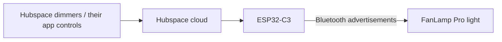

# Hubspace → FanLamp Pro light bridge

Use one or two Hubspace dimmer switches to control a FanLamp Pro ceiling fan's light through an ESP32-C3. The ESP32 receives switch events from Hubspace and sends Bluetooth commands directly to the fan. Once configured, it runs from USB power without a computer or Home Assistant server. **No separate Hubspace fan receiver is needed.**



## What works

- Light on/off and absolute brightness, always warm white with the cool channel at zero.
- One or two dimmers, with the latest cloud revision winning.
- Configurable logical brightness minimum for each switch.
- Duplicate Bluetooth commands are suppressed; credentials and the rolling Bluetooth counter survive restarts.
- Live push events handle changes; REST is used for initial state and reconnection, not continuous polling.
- No device-state writes, receiver dependency, or fan-light tile synchronization.

**Fan motor control is not implemented in the current bridge.** Use the original remote or FanLamp Pro for speed and breeze. A separate Hubspace switch for motor control is planned; its behavior and compatibility are not yet defined.

## Tested hardware and scope

| Part | Tested installation |
|---|---|
| Fan | [MODERN HABITAT ABL-CFL52-CHR, 42-inch DC fan](https://www.homedepot.com/p/335493267) |
| Bridge | ESP32-C3-DevKitC-02, 4 MB flash |
| Dimmers | Two Commercial Electric Hubspace smart dimmers, power attribute 10 and brightness attribute 20 |
| Fan protocol | `fanlamp_pro_v2/r`, signed payload, prefix `[0x10, 0x00, 0x56]` |

The switch-only installation was physically confirmed working on 2026-10-06. The public setup path generalizes the installed firmware; it has not been commissioned on a second installation. This is narrow, experimental support: the FanLamp Pro app name alone does not prove protocol compatibility, and other Hubspace products may use different attributes.

The ESP32 connects only to USB power. There are no GPIO connections to switches, the fan, or mains wiring. Keep the fan and switches installed according to their manufacturers' instructions.

## Build your own

Use Python **3.12 or newer** and a USB data cable. The commands below use `COM3` as an example; replace it with your board's port (`/dev/ttyUSB0`, etc.). Close serial monitors before uploading.

### 1. Install setup dependencies

```sh
git clone https://github.com/grdud/hubspace-fanlamp-bridge.git
cd hubspace-fanlamp-bridge
python -m venv .venv
```

Activate it with `.venv\Scripts\Activate.ps1` on Windows PowerShell, or `source .venv/bin/activate` on macOS/Linux. Then:

```sh
python -m pip install -r requirements.txt
```

Set up one or two compatible dimmer switches in Hubspace first. Confirm that your fan works with its original remote or FanLamp Pro.

### 2. Identify your paired Bluetooth controller

First install the separate capture firmware. It starts passively and only scans after a USB command:

```sh
python -m platformio run -d capture -t upload --upload-port COM3
python tools/capture.py capture --port COM3 --seconds 30 --output .local/remote.jsonl
```

During the capture, press a known light or fan button on the **same working remote** several times, with pauses. The tool prints decoded matches. Find a record matching `fanlamp_pro_v2/r`, with `codec_params` equal to `[true, [16, 0, 86]]`. Confirm that several button presses identify the same controller ID/index. Avoid using two different remotes during identification.

If your capture uses another codec, stop here: this firmware does not support it. The upstream [ha-ble-adv project](https://github.com/NicoIIT/ha-ble-adv) supports a much broader set of protocols.

Captures include local Bluetooth addresses and paired controller identities. Keep `.local/` private. This procedure copies an already paired controller identity; it does not automatically pair a new one or prove hardware compatibility.

### 3. Select your Hubspace devices

Replace `12` below with your chosen capture record number:

```sh
python tools/configure.py --capture .local/remote.jsonl --record 12
```

The tool prompts for your Hubspace login (and email verification code if required), lists your devices, and lets you choose one required dimmer and an optional second dimmer. It generates `include/bridge_config.h`, which Git ignores. It does **not** save cloud credentials or full device discovery data.

The default switch mapping is linear **1–100% → 1–100%**. A physical dimmer's low-end trim is not necessarily its logical API minimum. If you have measured a logical minimum of 30%, you can configure that explicitly with `--switch-min1 30` and/or `--switch-min2 30`. Values below that minimum clamp to 1%; do not select 30 just because the hardware trim is 30%.

### 4. Install the bridge firmware

```sh
python -m platformio run -t upload --upload-port COM3
```

The main and capture firmware are separate programs. Installing the main firmware replaces capture mode. Builds without a generated configuration compile for CI but cannot operate a fan.

### 5. Provision Wi-Fi and cloud access over USB

```sh
python tools/provision.py --port COM3
```

Enter your 2.4 GHz Wi-Fi name/password and sign into Hubspace. This fresh login supplies the board with a refresh token and account ID. The password and token are sent directly over the USB serial connection, not printed or saved in a local file. The public setup tool **does not retrieve your computer's saved Wi-Fi password**.

The ESP32 reboots and connects automatically. Optional diagnostics:

```sh
python tools/monitor.py --port COM3 --seconds 120
```

Look for `PUSH_CONNECTED` and `READY_SWITCH_ONLY`, then test light on/off and brightness from each selected switch. `TX` confirms a radio transmission, not that the fan received it. Check the actual fan.

### 6. Move it to permanent USB power

Use a standard 5 V USB adapter, with good 2.4 GHz Wi-Fi coverage and Bluetooth range to the fan. Keep your Hubspace switches online. Allow a minute or two after power-up for Wi-Fi, time synchronization, authentication, and cloud subscription. No computer is required afterward.

## Behavior and limitations

- Internet, Wi-Fi and online Hubspace dimmers are required. This does not create a new fan device in Hubspace; operate the selected dimmers or their app controls.
- Startup and reconnection establish a baseline without changing the light. Missed actions are not replayed; change a switch after reconnecting to reassert a state.
- The original remote and FanLamp Pro still work, but their changes are not observed or reported to Hubspace. Cached brightness assumes the last transmitted brightness remains set.
- Bluetooth advertisements have no acknowledgement. `TX` means a radio transmission, not confirmed physical delivery.
- Cloud delays vary. Each Bluetooth burst lasts 350 ms; a first ON may require brightness and ON bursts. No controlled end-to-end latency claim is made for this version.
- Authentication refreshes automatically. HTTPS work runs on a worker task while the main task services push, routing and Bluetooth. Long-duration unattended reliability and every failure mode are not proven.
- TLS validation is enabled. The unofficial API and root certificates may need maintenance.
- Credentials are in unencrypted ESP32 NVS. Never publish full flash dumps or personal configuration/captures.
- No OTA, captive portal, GPIO signal reader or mute toggle is included. Manage beeps with the fan's remote.

## Development and tests

See [architecture and diagnostics](docs/ARCHITECTURE.md) and [security notes](SECURITY.md).

```sh
python -m unittest discover -s tests -p 'test_*.py'
g++ -std=c++11 tests/test_switch_only.cpp -o test-switch
./test-switch
```

The codec self-test runs 14 synthetic upstream-generated vectors on boot. These include motor protocol vectors retained for codec coverage; the runtime only sends light commands. On Linux with the mbedTLS development package:

```sh
g++ -std=c++11 -Iinclude tests/test_codec.cpp -lmbedcrypto -o test-codec
./test-codec
```

GitHub Actions builds the bridge and capture firmware and runs native/Python tests. Hardware behavior requires commissioning. Serial commands are `STATUS`, `PAUSE`, `RESUME`, `REBOOT`, and the provisioning-only `CONFIG`. Pause survives reboot. Switch-event and radio timestamps are included in normal USB diagnostics; do not publish household activity logs unredacted.

### Project history

An earlier version used a genuine Hubspace fan receiver and synchronized its app tile. Direct dimmer-to-Bluetooth control made that receiver unnecessary for light control, so its integration was removed. The original implementation remains in [Git history](https://github.com/grdud/hubspace-fanlamp-bridge/commit/007d6c7).

## Credits and license

- [NicoIIT/ha-ble-adv](https://github.com/NicoIIT/ha-ble-adv): Bluetooth codec research, Python decoders, command mappings, and the basis for the narrow C++ encoder. Vendored codec files retain the upstream MIT license.
- [Expl0dingBanana/aioafero](https://github.com/Expl0dingBanana/aioafero): Hubspace/Afero login and discovery for setup, and reference cloud behavior.
- [NimBLE-Arduino](https://github.com/h2zero/NimBLE-Arduino), [ArduinoJson](https://arduinojson.org/), and the Espressif Arduino framework.
- Public TLS root certificates are from the Mozilla/curl certificate bundle, as noted in `src/trust.h`.

MIT; see [LICENSE](LICENSE) and [LICENSE-codec.txt](LICENSE-codec.txt). This is an independent hobby project, not affiliated with or endorsed by Home Depot, Hampton Bay, Afero, MODERN HABITAT, or FanLamp Pro.
